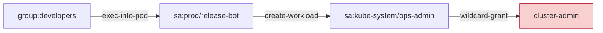

# rbacscope

**Find risky Kubernetes RBAC, and the multi-step paths to cluster-admin, before an attacker does.**

rbacscope runs as a small pod in your cluster. It continuously resolves *effective* permissions (including aggregated ClusterRoles), flags dangerous grants with the exact binding responsible, finds escalation chains like *exec into a pod → its ServiceAccount can create Deployments in kube-system → run as a cluster-admin ServiceAccount*, and, fed by the API server's audit webhook, tells you which permissions are never used and generates least-privilege Roles from real behaviour. It exposes Prometheus metrics and an HTML report, and every command can be run inside the pod with `kubectl exec`.



## Install

```sh
helm install rbacscope oci://ghcr.io/arifcse21/charts/rbacscope \
  --namespace rbacscope --create-namespace
```

Common options:

```sh
# k3s baseline, audit-based least privilege (see below), Prometheus Operator scraping and alerts
helm install rbacscope oci://ghcr.io/arifcse21/charts/rbacscope -n rbacscope --create-namespace \
  --set 'scan.baselines={k3s}' \
  --set auditWebhook.enabled=true \
  --set serviceMonitor.enabled=true \
  --set prometheusRule.enabled=true
```

| Value | Default | Purpose |
|---|---|---|
| `scan.interval` | `5m` | How often the cluster is rescanned |
| `scan.baselines` | `[]` | Distribution RBAC to hide (`k3s`) |
| `scan.ignoreRules` | `[]` | Accepted findings (see [Suppressing findings](#suppressing-findings)) |
| `scan.includePods` | `true` | List pods so exec/kubelet paths only target ServiceAccounts that actually run |
| `auditWebhook.enabled` | `false` | Receive API server audit events (unused permissions, `generate`) |
| `auditWebhook.retention` | `7d` | How much usage history to keep |
| `auditWebhook.persistence.enabled` | `false` | Keep usage on a PersistentVolume across rescheduling |
| `networkPolicy.ingressFrom` | `monitoring` namespace | Who may reach `/metrics` and `/report` |
| `serviceMonitor.enabled`, `prometheusRule.enabled` | `false` | Prometheus Operator integration |
| `image.digest` | `""` | Pin the image by digest |

All values: [charts/rbacscope/values.yaml](charts/rbacscope/values.yaml). The pod needs only `list` on Roles, bindings, ServiceAccounts and Pods (never Secrets), runs as non-root with a read-only filesystem, and its own chart scans clean.

## Use it

Open the report:

```sh
kubectl -n rbacscope port-forward svc/rbacscope 9090
# http://localhost:9090/report   findings, escalation paths, unused permissions
# http://localhost:9090/metrics  Prometheus metrics
```

Run any command inside the pod. It uses the pod's own read-only ServiceAccount, so nothing is installed anywhere else:

```sh
kubectl -n rbacscope exec deploy/rbacscope -- /rbacscope scan --live
kubectl -n rbacscope exec deploy/rbacscope -- /rbacscope paths --live                 # who can reach cluster-admin, and how
kubectl -n rbacscope exec deploy/rbacscope -- /rbacscope paths sa:ci/deployer --live  # shortest path from one subject
kubectl -n rbacscope exec deploy/rbacscope -- /rbacscope who-can get secrets -n prod --live
kubectl -n rbacscope exec deploy/rbacscope -- /rbacscope who-can create pods/exec --live
kubectl -n rbacscope exec deploy/rbacscope -- /rbacscope perms sa:ci/deployer --live
kubectl -n rbacscope exec deploy/rbacscope -- /rbacscope perms user:alice --group developers --live
kubectl -n rbacscope exec deploy/rbacscope -- /rbacscope rules
```

Optional shorthand:

```sh
alias rbacscope='kubectl -n rbacscope exec -i deploy/rbacscope -- /rbacscope'
rbacscope paths --live -o mermaid      # paste into a GitHub issue or PR
```

Check manifests before they reach the cluster by piping them in (`-f -` reads stdin):

```sh
kubectl -n rbacscope exec -i deploy/rbacscope -- /rbacscope scan -f - < deploy/rbac.yaml
helm template my-app ./chart | kubectl -n rbacscope exec -i deploy/rbacscope -- /rbacscope scan -f - --fail-on high
```

Other outputs: `-o json`, `-o sarif`, `-o html` (`scan`); `-o dot`, `-o mermaid` (`paths`).

## Least privilege from audit events

With `auditWebhook.enabled=true`, the API server streams audit events to the pod over HTTPS (separate port, bearer token, private CA generated by the chart). rbacscope keeps a rolling usage window and adds:

- an **Unused permissions** section in `/report`: bindings nobody used, and permissions inside bindings that were never exercised
- `rbacscope_bindings_by_usage{status="unused|partial|used"}` metrics
- `unused` and `generate` inside the pod

```sh
kubectl -n rbacscope exec deploy/rbacscope -- /rbacscope unused --live
kubectl -n rbacscope exec deploy/rbacscope -- /rbacscope unused --live --subject sa:ci/deployer
kubectl -n rbacscope exec deploy/rbacscope -- /rbacscope generate --subject sa:ci/deployer > ci-deployer-rbac.yaml
kubectl -n rbacscope exec deploy/rbacscope -- /rbacscope generate --subject sa:monitoring/agent --resource-names
```

`generate` writes a Role + RoleBinding per namespace the subject touched (and a ClusterRole for cluster-scoped use) containing only what it actually did. Review it, then `kubectl apply` it and remove the broad binding.

**Connect the API server once.** It needs an audit policy and a webhook kubeconfig pointing at the receiver:

```sh
kubectl -n rbacscope get svc rbacscope -o jsonpath='{.spec.clusterIP}'                        # receiver IP (port 9091)
kubectl -n rbacscope get secret rbacscope-audit-tls -o jsonpath='{.data.ca\.crt}'               # CA (already base64)
kubectl -n rbacscope get secret rbacscope-audit-token -o jsonpath='{.data.token}' | base64 -d  # bearer token
```

```yaml
# webhook kubeconfig on the control-plane node
apiVersion: v1
kind: Config
clusters:
  - name: rbacscope
    cluster:
      server: "https://<cluster-ip>:9091/audit"
      tls-server-name: rbacscope.rbacscope.svc     # the certificate's name; the IP is not in it
      certificate-authority-data: "<ca>"
users:
  - name: kube-apiserver
    user: { token: "<token>" }
contexts:
  - name: rbacscope
    context: { cluster: rbacscope, user: kube-apiserver }
current-context: rbacscope
```

HTTPS is required, not optional: Kubernetes clients, including the API server's webhook, silently drop the bearer token on `http://` URLs.

API server flags: `--audit-policy-file=<policy>` ([metadata-only example](examples/k3s-test/audit-policy.yaml); never logs request bodies), `--audit-webhook-config-file=<kubeconfig>`, `--audit-webhook-mode=batch`.
**k3s:** `sudo bash examples/k3s-test/enable-audit-webhook.sh` does all of this (`--undo` reverts).
Managed control planes (EKS, GKE, AKS) do not accept custom audit webhooks; there, export audit logs from the provider and run `generate`/`unused` with `--audit -` piped into the pod.

Usage is only as complete as the window. Cover a full business cycle (deploys, cron jobs, month-end) before removing access.

## Pull-request gate and drift

Fail a pull request that introduces new RBAC risk, with a Markdown summary for the PR:

```yaml
# .github/workflows/rbac.yml
on: pull_request
jobs:
  rbac:
    runs-on: ubuntu-latest
    permissions: { contents: read, security-events: write }
    steps:
      - uses: actions/checkout@v4
      - uses: Arifcse21/rbacscope@v0.6.1
        id: rbacscope
        with:
          path: deploy/
          fail-on: high
      - uses: github/codeql-action/upload-sarif@v3
        if: always()
        with:
          sarif_file: ${{ steps.rbacscope.outputs.sarif-file }}
          category: rbacscope
```

Findings appear in the Security tab and inline on the offending binding.

Drift between Git and the cluster, from the pod:

```sh
kubectl -n rbacscope exec -i deploy/rbacscope -- /rbacscope diff --before - --live < deploy/rbac.yaml
kubectl -n rbacscope exec deploy/rbacscope -- /rbacscope dump > snapshot.yaml                         # save today's RBAC
kubectl -n rbacscope exec -i deploy/rbacscope -- /rbacscope diff --before - --live --fail-on-new high < snapshot.yaml
```

`diff` reports new, worsened and resolved findings, **new escalation paths to cluster-admin**, and added/removed grants (`-o markdown` for PR comments).

## Monitoring

| Metric | Meaning |
|---|---|
| `rbacscope_findings{rule,severity}` | Current findings (every rule exported, 0 when clean) |
| `rbacscope_escalation_paths` | Subjects with a multi-step path to cluster-admin |
| `rbacscope_bindings_by_usage{status}` | Bindings by audit usage (with `auditWebhook`) |
| `rbacscope_audit_window_requests`, `rbacscope_audit_events_received_total`, `rbacscope_audit_requests_rejected_total` | Audit receiver health |
| `rbacscope_suppressed_findings`, `rbacscope_grants` | Ignored findings; effective grants |
| `rbacscope_scans_total{result}`, `rbacscope_last_success_timestamp_seconds`, `rbacscope_scan_duration_seconds` | Exporter health |

`prometheusRule.enabled=true` installs alerts for escalation paths, critical findings and stale scans.

## What it detects

| Rule | Severity | Finding |
|---|---|---|
| RBAC001 | critical | `escalate` / `bind` on roles |
| RBAC002 | critical | `impersonate` users, groups, ServiceAccounts |
| RBAC003 | high | Create/modify Roles and bindings |
| RBAC004 | high | Read Secrets |
| RBAC005 | high | Mint ServiceAccount tokens (`serviceaccounts/token`) |
| RBAC006 | high | `pods/exec`, `pods/attach` |
| RBAC007 | medium | Create pods or workload controllers |
| RBAC008 | critical | `nodes/proxy` (kubelet API) |
| RBAC009 | high | Approve CertificateSigningRequests |
| RBAC010 | high | Manage admission webhooks |
| RBAC011 | high/critical | Wildcard verbs/resources |
| RBAC012 | critical | Bound to `cluster-admin` |
| RBAC013 | critical/high | Grants to anonymous / all-authenticated / all-ServiceAccount groups |
| RBAC014 | medium | Permissions on the `default` ServiceAccount |
| RBAC015 | low | Binding references a missing role (latent escalation) |
| RBAC016 | medium | Create PersistentVolumes (hostPath) |
| RBAC017 | critical | Multi-step escalation path to cluster-admin |

Escalation-path techniques (an edge means "A can obtain B's privileges"):

| Technique | Edge exists when A can… |
|---|---|
| `wildcard-grant` | already holds `*` on `*` (cluster or namespace) |
| `bind-role` | `bind` cluster-admin and create (Cluster)RoleBindings |
| `escalate-role` | `escalate` + update (Cluster)Roles |
| `impersonate` | impersonate the user, group or ServiceAccount |
| `mint-token` | create `serviceaccounts/token` for B |
| `steal-token-secret` | read Secrets in B's namespace while B has a legacy token Secret |
| `create-workload` | create pods/Deployments/Jobs/… in B's namespace (and run as B) |
| `exec-into-pod` | `pods/exec` where a running pod uses B |
| `kubelet-proxy` | `nodes/proxy` while a running pod uses B |

## Suppressing findings

Accepted findings go in the chart values (each entry needs at least one of `rule`, `subject`, `binding`; `*` globs):

```yaml
scan:
  baselines: [k3s]
  ignoreRules:
    - rule: RBAC004
      subject: "sa:monitoring/prometheus"
      reason: reads TLS secrets for blackbox probes (SEC-123)
    - subject: "sa:argocd/*"
      binding: "argocd-*"
      reason: Argo CD manages the cluster
```

## Security

The report and metrics describe your cluster's weak spots: keep the Service ClusterIP-only and the NetworkPolicy in place. Release binaries, the image and the chart are signed with Sigstore and carry SLSA provenance; see [SECURITY.md](SECURITY.md) for verification and vulnerability reporting.

## Roadmap

- [x] **v0.1–v0.3**: rules, effective permissions, escalation paths, SARIF, audit-log least privilege
- [x] **v0.4–v0.5**: live cluster access, `diff`, HTML report, in-cluster exporter, Helm chart, signed releases
- [x] **v0.6**: pod-first: API server audit webhook receiver, unused-permission report and metrics, `generate`/`unused` via `kubectl exec`
- [ ] **v0.7**: admission-aware findings (Pod Security Admission, ValidatingAdmissionPolicy), `RBACReport` CRD

## Contributing

See [CONTRIBUTING.md](CONTRIBUTING.md) for building, testing and adding detection rules.

## License

Apache-2.0
