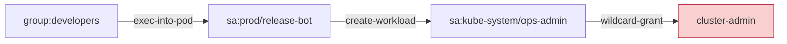

# rbacscope

**Find risky Kubernetes RBAC, and the multi-step paths to cluster-admin, before an attacker does.** rbacscope is a single static binary. It resolves *effective* permissions (including aggregated ClusterRoles), flags dangerous grants with the exact binding responsible, and finds escalation chains like *exec into a pod → its ServiceAccount can create Deployments in kube-system → run as a cluster-admin SA*. It also reads audit logs and generates least-privilege Roles from what each identity actually uses. It works offline from manifests, a `kubectl` dump and audit logs, reads the live cluster directly, diffs RBAC between Git revisions for pull-request gates, and can run in-cluster as a Prometheus exporter.

```console
$ rbacscope paths group:developers -f testdata/bad-cluster
┌──────────────────┬──────┬──────────────────────────────────────────────────────────────────────────────────────┐
│ SOURCE           ┆ HOPS ┆ PATH                                                                                 │
╞══════════════════╪══════╪══════════════════════════════════════════════════════════════════════════════════════╡
│ group:developers ┆ 3    ┆ -> sa:prod/release-bot  [exec-into-pod]                                              │
│                  ┆      ┆      exec into a pod in prod running as sa:prod/release-bot                          │
│                  ┆      ┆      via RoleBinding prod/developers-debug -> Role debugger                          │
│                  ┆      ┆ -> sa:kube-system/ops-admin  [create-workload]                                       │
│                  ┆      ┆      create deployments in kube-system running as sa:kube-system/ops-admin           │
│                  ┆      ┆      via RoleBinding kube-system/release-bot-deploy -> ClusterRole workload-deployer │
│                  ┆      ┆ -> cluster-admin  [wildcard-grant]                                                   │
│                  ┆      ┆      holds * on * cluster-wide                                                       │
│                  ┆      ┆      via ClusterRoleBinding ops-admin -> ClusterRole cluster-admin                   │
└──────────────────┴──────┴──────────────────────────────────────────────────────────────────────────────────────┘
```



## Usage

```sh
rbacscope scan --live                             # current kubeconfig context, read-only `list` calls
rbacscope scan --live --context prod -o html > rbac-report.html
rbacscope dump > dump.yaml                        # save cluster RBAC for offline use or later `diff`
# (equivalent without rbacscope access to the cluster:)
kubectl get roles,rolebindings,clusterroles,clusterrolebindings,serviceaccounts,pods -A -o yaml > dump.yaml

rbacscope scan -f dump.yaml                       # all findings, including escalation paths (RBAC017)
rbacscope scan -f dump.yaml --baseline k3s        # hide RBAC that ships with k3s
rbacscope scan -f deploy/ --fail-on high          # CI gate on manifests in a repo
rbacscope scan -f deploy/ -o sarif > rbac.sarif   # GitHub code scanning, with file:line locations

rbacscope paths -f dump.yaml                      # every subject that can reach cluster-admin in 2+ hops
rbacscope paths sa:ci/deployer -f dump.yaml       # shortest path from one subject
rbacscope paths -f dump.yaml -o dot | dot -Tsvg > paths.svg
rbacscope paths -f dump.yaml -o mermaid           # paste into a GitHub issue/PR

rbacscope who-can get secrets -n prod -f dump.yaml
rbacscope who-can create pods/exec -f dump.yaml
rbacscope perms sa:ci/deployer -f dump.yaml       # includes implicit system:serviceaccounts groups
rbacscope perms user:alice --group developers -f dump.yaml
rbacscope rules
```

## Pull-request gate and drift detection

`diff` compares two RBAC states and reports new, worsened and resolved findings, **new escalation paths to cluster-admin**, and added/removed grants. Moving a binding to another file is not a change.

```sh
rbacscope diff --before main-manifests/ --after deploy/ --fail-on-new high          # exit 1 on new high/critical risk
rbacscope diff --before main-manifests/ --after deploy/ -o markdown > rbac-diff.md   # PR comment
rbacscope diff --before deploy/ --live                                               # Git vs. cluster drift
```

```yaml
# .github/workflows/rbac-diff.yml (excerpt)
- uses: actions/checkout@v4
  with: { fetch-depth: 0 }
- run: git worktree add /tmp/base "origin/${{ github.base_ref }}"
- run: rbacscope diff --before /tmp/base/deploy --after deploy --fail-on-new high -o markdown | tee rbac-diff.md
```

Example: a PR that adds a harmless-looking cluster-admin ServiceAccount to a namespace where a debug account can mint tokens:

```text
NEW ESCALATION PATHS TO CLUSTER-ADMIN
  + sa:rbacscopetest/debug-helper -> [mint-token] sa:rbacscopetest/ops-admin -> [wildcard-grant] cluster-admin
  + sa:rbacscopetest/default -> [create-workload] sa:rbacscopetest/ops-admin -> [wildcard-grant] cluster-admin
```

## In-cluster exporter

`rbacscope serve` rescans the cluster on an interval and serves `/metrics` (Prometheus), `/report` (HTML), `/healthz` and `/readyz`.

```sh
helm install rbacscope oci://ghcr.io/arifcse21/charts/rbacscope -n rbacscope --create-namespace \
  --set 'scan.baselines={k3s}' --set serviceMonitor.enabled=true --set prometheusRule.enabled=true
kubectl -n rbacscope port-forward svc/rbacscope 9090   # then open http://localhost:9090/report
# without Helm: kubectl apply -f deploy/kubernetes/rbacscope.yaml
```

Chart values: `scan.interval`, `scan.baselines`, `scan.ignoreRules` (same schema as `.rbacscope-ignore.yaml`), `scan.includePods`, `networkPolicy.ingressFrom`, `serviceMonitor.*`, `prometheusRule.*` (alerts for escalation paths, critical findings and stale scans), `image.digest` and the usual scheduling/resources options. See [charts/rbacscope/values.yaml](charts/rbacscope/values.yaml).

| Metric | Meaning |
|---|---|
| `rbacscope_findings{rule,severity}` | current findings (every rule is exported, 0 when clean) |
| `rbacscope_escalation_paths` | subjects with a multi-step path to cluster-admin |
| `rbacscope_suppressed_findings`, `rbacscope_grants` | ignored findings; effective grants |
| `rbacscope_scans_total{result}`, `rbacscope_last_success_timestamp_seconds`, `rbacscope_scan_duration_seconds` | exporter health |

```yaml
# Prometheus alert
- alert: RBACEscalationPath
  expr: rbacscope_escalation_paths > 0
  for: 15m
  annotations: { summary: "A subject can escalate to cluster-admin; see /report" }
```

The exporter needs only `list` on RBAC objects, ServiceAccounts and Pods (no Secrets), runs as non-root with a read-only filesystem, and keeps only each pod's namespace, ServiceAccount and phase. rbacscope's own manifest scans clean. On k3s without a registry, load the local image with `docker save rbacscope:dev | sudo k3s ctr images import -` and set `image: rbacscope:dev`.

## Least privilege from audit logs

Point rbacscope at a Kubernetes audit log (JSON lines, `audit.k8s.io/v1`, `Metadata` level is enough):

```sh
# Minimal Role/RoleBinding per namespace (+ ClusterRole for cluster-scoped use) from observed requests
rbacscope generate --subject sa:ci/deployer --audit audit.log > ci-deployer-rbac.yaml
rbacscope generate --subject sa:monitoring/agent --audit audit.log --resource-names   # pin get/patch/... to object names
rbacscope generate --subject group:developers --audit audit.log                     # all users seen in the group

# Granted vs. used: bindings nobody used, and permissions inside bindings that were never exercised
rbacscope unused -f dump.yaml --audit audit.log
rbacscope unused -f dump.yaml --audit audit.log --subject sa:ci/deployer -o json
```

```text
STATUS   SUBJECT              GRANTED VIA                                            REQUESTS  USED                NEVER USED
UNUSED   sa:ci/deployer       RoleBinding kube-system/ci-token-minter -> Role ...    0                             create serviceaccounts/token
PARTIAL  sa:monitoring/agent  ClusterRoleBinding monitoring -> ClusterRole ...       24        list pods, watch …  get secrets, list secrets
USED     user:support-bot     ClusterRoleBinding support-impersonate -> ...          2         impersonate users
```

Notes:
- Denied (403) requests are left out unless `--include-denied`; requests made while impersonating count for the impersonated identity, and as `impersonate` for the caller.
- Usage is only as complete as the audit window and policy. Look at a full business cycle (deploys, cron jobs, month-end) before removing access.
- `zcat` rotated `.gz` logs into `--audit -`. On k3s, [examples/k3s-test/enable-audit.sh](examples/k3s-test/enable-audit.sh) turns audit logging on with a metadata-only policy.

Every command that takes `-f` also accepts `--live` (with optional `--context`). `-f -` reads stdin. Built-in `system:*` bindings and control-plane identities are hidden by default; `--include-builtin` shows them.

## Escalation techniques

`paths` and RBAC017 build a graph where an edge means "A can obtain B's privileges":

| Technique | Edge exists when A can… |
|---|---|
| `wildcard-grant` | already holds `*` on `*` (cluster or namespace) |
| `bind-role` | `bind` the cluster-admin ClusterRole and create (Cluster)RoleBindings |
| `escalate-role` | `escalate` + update (Cluster)Roles |
| `impersonate` | impersonate the user, group or ServiceAccount |
| `mint-token` | create `serviceaccounts/token` for B |
| `steal-token-secret` | read Secrets in B's namespace *and* B has a legacy token Secret |
| `create-workload` | create pods/Deployments/Jobs/… in B's namespace (and run as B) |
| `exec-into-pod` | `pods/exec` in a namespace where a running pod uses B |
| `kubelet-proxy` | `nodes/proxy` (kubelet API) while a running pod uses B |

Only identities that hold permissions are graph targets. Without pods in the input, exec/kubelet edges are marked *assumed*.

## What it detects

| Rule | Severity | Finding |
|---|---|---|
| RBAC001 | critical | `escalate` / `bind` on roles |
| RBAC002 | critical | `impersonate` users, groups, ServiceAccounts |
| RBAC003 | high | Create/modify Roles and bindings |
| RBAC004 | high | Read Secrets |
| RBAC005 | high | Mint ServiceAccount tokens (`serviceaccounts/token`) |
| RBAC006 | high | `pods/exec`, `pods/attach` |
| RBAC007 | medium | Create pods or workload controllers |
| RBAC008 | critical | `nodes/proxy` (kubelet API) |
| RBAC009 | high | Approve CertificateSigningRequests |
| RBAC010 | high | Manage admission webhooks |
| RBAC011 | high/critical | Wildcard verbs/resources |
| RBAC012 | critical | Bound to `cluster-admin` |
| RBAC013 | critical/high | Grants to anonymous / all-authenticated / all-SA groups |
| RBAC014 | medium | Permissions on the `default` ServiceAccount |
| RBAC015 | low | Binding references a missing role (latent escalation) |
| RBAC016 | medium | Create PersistentVolumes (hostPath) |
| RBAC017 | critical | Multi-step escalation path to cluster-admin |

## Suppressing accepted findings

Put a `.rbacscope-ignore.yaml` in the working directory (or pass `--ignore-file`). Each entry must narrow by at least one of `rule`, `subject`, `binding` (globs with `*`):

```yaml
ignore:
  - rule: RBAC004
    subject: "sa:monitoring/prometheus"
    reason: reads TLS secrets for blackbox probes (SEC-123)
  - subject: "sa:argocd/*"
    binding: "argocd-*"
    reason: Argo CD manages the cluster
```

`--baseline k3s` suppresses the RBAC that k3s installs (helm-controller, Traefik, local-path-provisioner, cloud controller). Use `--show-suppressed` to audit what is hidden. See [examples/rbacscope-ignore.yaml](examples/rbacscope-ignore.yaml).

## GitHub Action

```yaml
jobs:
  rbac:
    runs-on: ubuntu-latest
    permissions: { contents: read, security-events: write }
    steps:
      - uses: actions/checkout@v4
      - uses: Arifcse21/rbacscope@v0.2.0
        id: rbacscope
        with:
          path: deploy/            # space-separated files/dirs
          fail-on: high            # empty = never fail
      - uses: github/codeql-action/upload-sarif@v3
        if: always()
        with:
          sarif_file: ${{ steps.rbacscope.outputs.sarif-file }}
          category: rbacscope
```

Findings appear in the Security tab and inline on the offending binding in pull requests.

## Install

Release binaries, the image and the chart are signed; see [SECURITY.md](SECURITY.md) for `cosign` / `gh attestation verify` commands.

```sh
cargo install --path rbacscope-cli                          # Rust 1.95+
cargo install --path rbacscope-cli --no-default-features    # offline-only, no kube-rs (smaller)
# or
docker build -t rbacscope . && docker run --rm -i rbacscope scan -f - < dump.yaml
```

## Roadmap

- [x] **v0.1**: YAML/JSON loader, effective-permission resolution with aggregation, 16 rules, `scan` / `who-can` / `perms`, table and JSON output
- [x] **v0.2**: escalation-path graph (`paths`, RBAC017), DOT/Mermaid export, SARIF with file:line locations, GitHub Action, ignore files and `k3s` baseline
- [x] **v0.3**: least privilege: audit-log parser, `generate` minimal Roles, `unused` granted-vs-used report
- [x] **v0.4**: `diff` (PR gate, drift), HTML report, `--live` cluster access via kube-rs, `dump`, in-cluster exporter (`serve`) with Prometheus metrics
- [x] **v0.5**: Helm chart (ServiceMonitor, PrometheusRule, NetworkPolicy), tag-triggered release with static binaries for 5 platforms, multi-arch image, SBOM, cosign keyless signatures and SLSA provenance ([SECURITY.md](SECURITY.md))
- [ ] **v0.6**: admission-aware findings (Pod Security Admission, ValidatingAdmissionPolicy/CEL rules that block a technique), operator mode with a `RBACReport` CRD
- [ ] Baselines for EKS, GKE, AKS, OpenShift (contributions welcome: they need a real cluster dump)

## Development

```sh
cargo test --workspace
cargo clippy --workspace --all-targets -- -D warnings
cargo run -- scan -f testdata/bad-cluster      # intentionally vulnerable demo cluster
cargo run -- paths -f testdata/bad-cluster
```

Layout: `crates/rbacscope-core` (model, loader, resolution, graph, rules, suppression, audit, generate, unused), `crates/rbacscope-report` (table/JSON/SARIF/DOT/Mermaid/Markdown/HTML), `rbacscope-cli` (binary; `live.rs` and `serve.rs` behind the default `live` feature). See [CONTRIBUTING.md](CONTRIBUTING.md) to add a rule. To test against a local cluster, see [examples/k3s-test](examples/k3s-test).

## License

Apache-2.0
